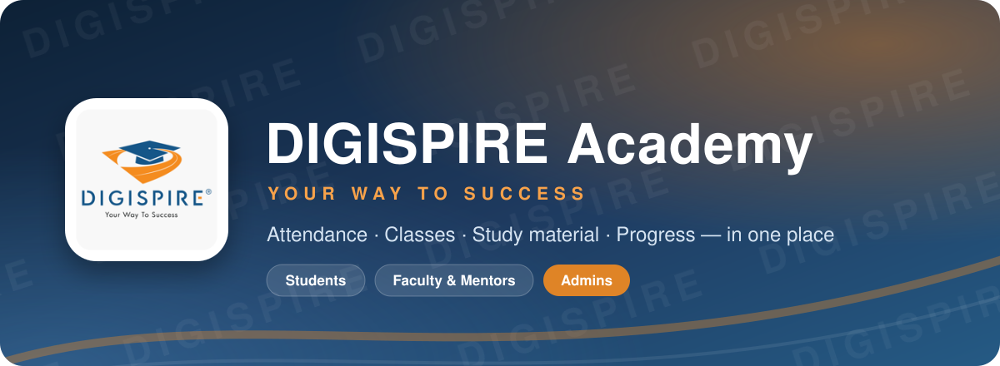

 

**The official app of DIGISPIRE Academy for students, mentors and the academy team.** 
Mark attendance with one scan, follow your syllabus, open study material, submit assignments 
and see your progress, all in one place, on your phone or computer.

 

&nbsp;

&nbsp;

 

## ✨ Highlights

<table>
  <tr>
    <td width="33%" valign="top">
      <h3>📲 Attendance in seconds</h3>
      Scan the QR code shown in class, or type the short code. Done, you're marked present.
    </td>
    <td width="33%" valign="top">
      <h3>📚 Your syllabus, your pace</h3>
      See every module and topic of your course and exactly what you've completed.
    </td>
    <td width="33%" valign="top">
      <h3>🎬 Study material in one place</h3>
      Notes, PDFs, Google Drive files and YouTube lessons open right inside the app.
    </td>
  </tr>
  <tr>
    <td width="33%" valign="top">
      <h3>📝 Assignments & feedback</h3>
      Submit your work and read your mentor's review and feedback.
    </td>
    <td width="33%" valign="top">
      <h3>📢 Instant announcements</h3>
      Important notices reach you right away, with notifications on your phone.
    </td>
    <td width="33%" valign="top">
      <h3>✉️ Reports by email</h3>
      A summary after every class you attend, and your attendance report every month.
    </td>
  </tr>
  <tr>
    <td width="33%" valign="top">
      <h3>🪪 Digital student ID</h3>
      Your personal ID card with a QR code, always in your pocket.
    </td>
    <td width="33%" valign="top">
      <h3>📊 Clear reports for mentors</h3>
      Attendance, progress and who needs help, visible at a glance.
    </td>
    <td width="33%" valign="top">
      <h3>📱 Works like an app</h3>
      Install it on your phone's home screen. Pages you've opened still work offline.
    </td>
  </tr>
</table>

## 👩‍🎓 For Students

| | What you can do |
|:--:|:--|
| 🏠 | **Dashboard**: your attendance percentage, course progress, latest announcements and your mentor, all on one screen. |
| ✅ | **Mark Attendance**: scan the class QR code with your camera, or type the code your mentor shows. |
| 📅 | **Attendance calendar**: see each day of the month marked as present, absent, leave, holiday or cancelled class. |
| 📘 | **My Courses**: follow your course module by module, see which topics are done, and request a revision if a topic needs another look. |
| 🎬 | **Study Materials**: open notes, PDFs, Drive files and video lessons without leaving the app. Pinned notes stay on top, and you can save your favourites. |
| 📝 | **Assignments**: submit your project or homework link and see your mentor's review and feedback. |
| 🪪 | **My Profile & ID card**: your digital student ID with QR code, your details, and a safe place to change your password. |
| ✉️ | **Emails**: after each class you attend, you get a short report with the topics covered and the tasks given. On the last day of every month, you get your own attendance report. |

## 👨‍🏫 For Faculty & Mentors

| | What you can do |
|:--:|:--|
| 📡 | **Live attendance**: show a QR code on screen and watch students check in live. Each code expires after 5 minutes, so attendance stays honest. |
| ✍️ | **Manual entries**: mark present, leave or makeup attendance for any student and date. |
| 🗓️ | **Schedules**: set class days and timings, plan makeup classes, add holidays and cancel classes when needed. |
| 📨 | **Class Reports**: after class, send one email to everyone who attended, with the topics covered and the tasks for today. Students never see each other's email addresses. |
| 📊 | **Attendance Reports**: each student's attendance with a day-by-day calendar. Students with low attendance or repeated absences are highlighted automatically. Download to Excel or print. |
| 💌 | **Personal emails**: send a student their own attendance warning, pending-topics reminder or absence follow-up, with a personal note from you. |
| 🏆 | **Completion Reports**: see who is ahead, on track or behind schedule, and mark topics or modules as complete. |
| 🗂️ | **Assignments & revisions**: review submissions, give feedback and handle revision requests. |
| 📢 | **Announcements**: publish notices for all students or a single batch, with instant phone notifications. |
| 💬 | **Daily WhatsApp summary**: create a ready-to-share attendance summary for any batch in one tap. |

## 🛡️ For Admins

| | What you can do |
|:--:|:--|
| 👥 | **Students & staff**: add students and faculty, assign batches, courses and mentors, issue ID cards, and mark students active or inactive. |
| 🎓 | **Courses & syllabus**: build each course from modules and topics. |
| 📁 | **Study material library**: add notes, PDFs, Drive files and videos, and pin the important ones. |
| ✉️ | **Email Center**: preview and send the monthly attendance reports and see the history of every email sent. |

## 🚀 Getting started

<table>
  <tr>
    <td width="50%" valign="top">
      <h3>👩‍🎓 Students</h3>
      <ol>
        <li>Open <a href="https://digispire.vercel.app"><b>digispire.vercel.app</b></a></li>
        <li>Choose <b>Student</b></li>
        <li>Sign in with your <b>registered phone number</b> and the password the academy gave you</li>
        <li>Change your password in <b>My Profile</b></li>
      </ol>
      💡 Make sure the academy has your correct email address so you receive your class and monthly reports.
    </td>
    <td width="50%" valign="top">
      <h3>👨‍🏫 Faculty & Admins</h3>
      <ol>
        <li>Open <a href="https://digispire.vercel.app"><b>digispire.vercel.app</b></a></li>
        <li>Choose <b>Faculty</b></li>
        <li>Sign in with your <b>academy email</b> and password</li>
        <li>Start from the <b>Dashboard</b></li>
      </ol>
      💡 New staff accounts are created by an admin under <b>Teachers & Staff</b>.
    </td>
  </tr>
</table>

## 📱 Install it on your phone

| Phone | How to install |
|:--|:--|
| **Android** (Chrome) | Open the website → tap <kbd>⋮</kbd> → **Install app** / **Add to Home screen**, or use the DIGISPIRE Android app |
| **iPhone** (Safari) | Open the website → tap <kbd>Share</kbd> → **Add to Home Screen** |
| **Computer** | Works in any modern browser (Chrome, Edge, Safari, Firefox) |

Once installed, DIGISPIRE opens full-screen like any other app and updates itself automatically.

## ✉️ Emails from the academy

| Email | When it arrives | Who receives it |
|:--|:--|:--|
| 📨 **Class report** | After each class | Students who attended that class |
| 📅 **Monthly attendance report** | On the last day of every month | Every active student, each with their own report |
| 💌 **Attendance / syllabus / absence reminder** | When your mentor sends one | Only you |

Emails come from the academy's official address. Group emails are sent privately, so no one can see who else received them.

## 🔒 Privacy & safety

- 🔐 Every account is protected by a personal login.
- 👀 Only faculty and admins can see attendance reports.
- ✉️ Your email address is never shown to other students.
- 📄 Read how your information is used in our [Privacy Policy](https://digispire.vercel.app/privacy-policy).

## ❓ Frequently asked questions

<b>The QR code says it has expired. What do I do?</b>

 
Class QR codes are valid for 5 minutes. Ask your mentor to show a fresh code, or type the new code shown on screen.

<b>I'm not receiving any emails from the academy.</b>

 
Check your Spam or Promotions folder first. If they're not there, ask the academy to check the email address saved on your profile.

<b>My attendance for a day looks wrong.</b>

 
Tell your mentor the date. They can review and correct it.

<b>I forgot my password.</b>

 
Contact the academy office or your mentor to have your password reset.

<b>Can I use DIGISPIRE on a computer?</b>

 
Yes. Open <a href="https://digispire.vercel.app">digispire.vercel.app</a> in any modern browser and sign in.

## 💬 Need help?

Talk to your **mentor** or the **DIGISPIRE Academy office**. We're happy to help.

 

 

© 2026 DIGISPIRE Academy. The DIGISPIRE name and logo belong to DIGISPIRE Academy. 
App designed & developed by <a href="https://github.com/ABVicky"><b>Vicky Prasad Mahato</b> (@ABVicky)</a>.

